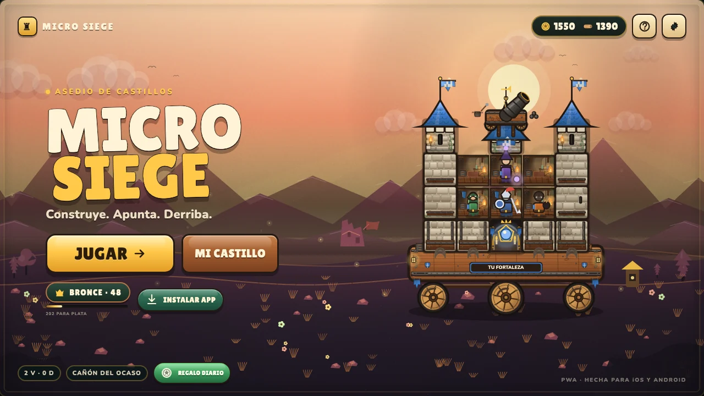
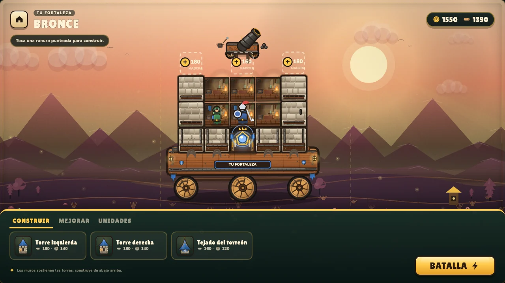
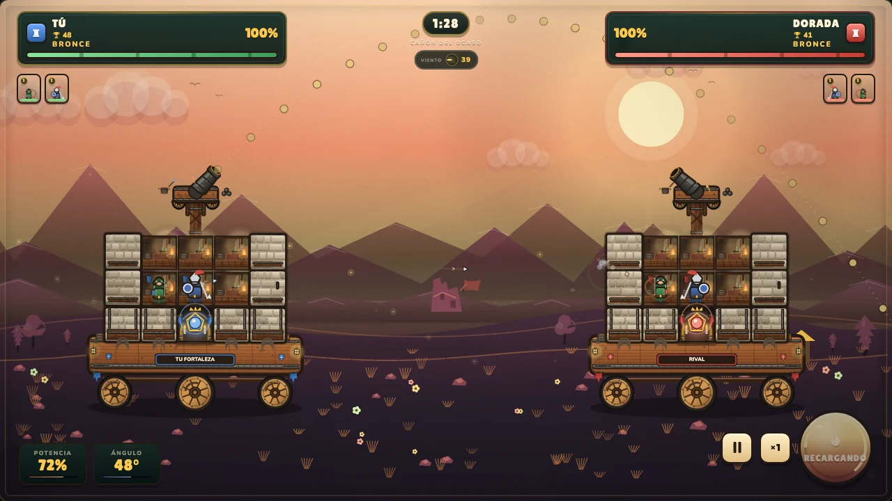
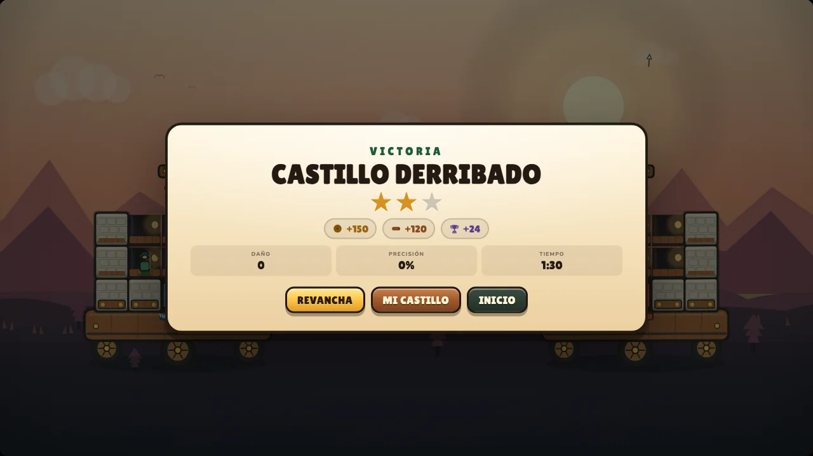
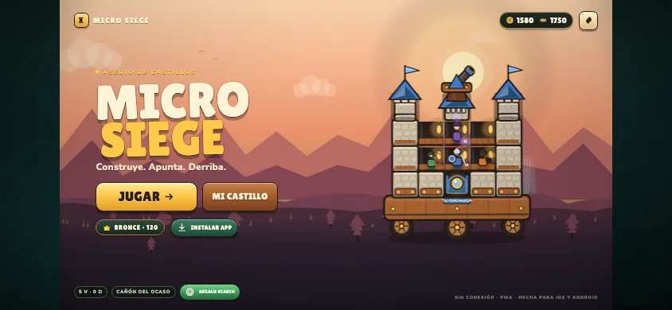

# Micro Siege

**Asedio de castillos con ruedas.** Construye tu fortaleza, coloca la guarnición, apunta con el viento y derriba el núcleo rival.

**v0.2 · pase de detalle.** Todo el arte sigue siendo procedural: no hay sprites externos.

### ▶ Juega online

**https://igutiez.github.io/micro-siege/**

PWA instalable y offline. En Chrome/Edge pulsa **Instalar app**. En iPhone/iPad: **Compartir → Añadir a pantalla de inicio**.



## Qué hay dentro

- **Duelo 1v1 en tiempo real contra la IA**: cañón, viento cambiante, munición con caída, núcleo y destrucción por módulos.
- **Castillo con 9 módulos**: cimientos, muros, torres y tejado. Si destruyes el apoyo, lo que hay encima se derrumba.
- **8 unidades** con proyectiles, roles y animaciones propias: arquera, caballero, bombardero, asedio, maga, ingeniera, bruto y ballestera.
- **Progresión local**: monedas, madera, mejoras de módulos y unidades, copas, rangos Bronce/Plata/Oro/Leyenda, regalo diario y cuatro arenas.
- **PWA real**: manifiesto con capturas y atajos, service worker (`micro-siege-v6`), caché offline, iconos maskable, pantalla completa y orientación bloqueada.
- **iOS + Android**: 16:9 adaptable, full-bleed en móvil horizontal, safe areas, objetivos táctiles de 44 px y controles táctiles, giro obligatorio en vertical e instalación guiada en iOS.
- **Audio procedural** con WebAudio: cañones, impactos, derrumbes, monedas, victoria/derrota y música ambiental.
- **Cero dependencias de runtime**: TypeScript + Canvas 2D + Vite. Todo el arte se dibuja por código.

### El pase de detalle de la v0.2

- **Fondos pintados por capas**: cielo con rayos, montañas con nieve y aristas, ruinas, mirador, molino, faro, estanque, camino, vallas, flores, hierba y partículas ambientales por arena.
- **Materiales con historia**: piedra labrada con juntas, grano y musgo; madera con vetas y nudos; hierro con remaches; tejados de teja solapada; desgaste, grietas y humo en los módulos dañados.
- **Castillo habitable**: interiores cálidos, antorchas, estandartes, ventanas, estanterías, barriles, cajas, telarañas y suelos de tablón. La cureña lleva pólvora, balas, resortes y un mástil de asedio.
- **Unidades más vivas**: capas, botas, cinturones, armas con brillo, parpadeo, animación de reposo y caídos que dejan escudo y casco.
- **Combate con impacto**: intro con cuenta atrás, estelas, fogonazo, humo, chispas, derrumbe, temblor, confeti y resultado con corona, notas y progreso de rango.
- **HUD de artillería**: compás de viento, medidores de potencia y ángulo, anillo de recarga, rangos junto a las copas, retratos con nivel y salud segmentada.
- **Taller más claro**: miniaturas dibujadas de cada módulo, pips de nivel en unidades, pista contextual y confirmación propia para borrar el progreso.
- **Ayuda y onboarding**: modal **Cómo jugar** con los tres pasos, controles de teclado y estado de conexión/PWA.






## Cómo se juega

| Acción | Táctil | Teclado |
| --- | --- | --- |
| Apuntar | Arrastra desde el cañón y suelta | Flechas ↑/↓ (ángulo), ←/→ (potencia) |
| Disparar | Suelta el arrastre o pulsa **Disparar** | Espacio |
| Pausa | Botón de pausa | `P` o `Esc` |
| Velocidad ×2 | Botón `×1`/`×2` | `S` |
| Construir / mejorar | Taller → pestañas **Construir**, **Mejorar**, **Unidades** | — |
| Ayuda | Botón **?** de la portada o **Ajustes → Cómo jugar** | — |

El objetivo es dejar a cero el **núcleo** del rival antes de que se agote el tiempo. Si el tiempo termina, gana quien conserve más salud estructural. Las unidades no terminan la partida por sí solas: siguen disparando aunque mueran todas.

## Desarrollo

```bash
npm install
npm run dev         # http://127.0.0.1:5276
npm test            # 23 tests de física, economía, castillo y batalla
npm run build       # typecheck + build de producción
npm run build:pages # build con base /micro-siege/
npm run deploy      # publica dist en la rama gh-pages
```

### Estructura

```text
src/
  game/
    art.ts       # fondos, castillos, unidades, partículas y UI de canvas
    audio.ts     # sintetizador WebAudio
    battle.ts    # simulación 1v1, IA, proyectiles y fin de partida
    castle.ts    # rejilla 5×4, daño, apoyo estructural y derrumbe
    config.ts    # módulos, unidades, arenas y economía
    detail.ts    # capas de paisaje, vegetación, clima y caché del fondo
    game.ts      # orquestación de pantallas, entrada y render
    physics.ts   # balística, viento y búsqueda de tiro de la IA
    profile.ts   # perfil, localStorage, recompensas y rangos
    types.ts     # tipos compartidos
    ui.ts        # HUD, taller, ajustes, pausa y resultado
  main.ts        # arranque y registro del service worker
  pwa.ts         # instalación y antes de instalar
  styles.css     # sistema visual responsive
```

Los atajos de la PWA usan `?screen=build` y `?screen=play`. La URL se limpia después de entrar para que recargar no repita la acción.

## Privacidad

Todo el progreso se guarda en `localStorage` del dispositivo. No hay cuentas, analítica, anuncios ni llamadas a servidores. La batalla es offline contra la IA.

## Créditos y alcance

Código, arte procedural, nombres y textos originales. Tipografías **Lilita One** y **Nunito** bajo SIL Open Font License (ver `public/licenses/`). Inspirado en la mecánica clásica de asedio con castillos móviles; no está afiliado, patrocinado ni respaldado por ningún juego o estudio existente. No se redistribuyen assets de terceros.

## Licencia

MIT. Consulta [LICENSE](LICENSE).
